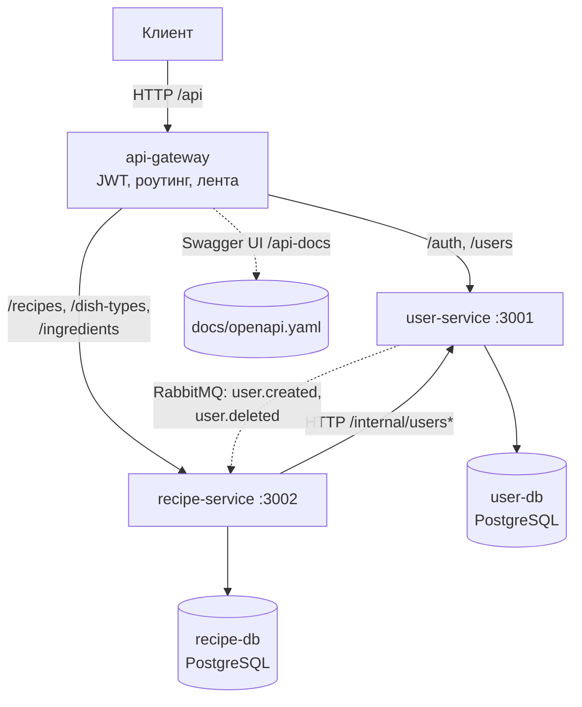

# Архитектура

Приложение разделено на три сервиса: шлюз, пользователи и рецепты. Шлюз —
единственная публичная точка входа, у каждого сервиса своя база данных
(database-per-service), а события об удалении пользователей передаются через
RabbitMQ.

## Схема

## Сервисы

| Сервис | Порт | Ответственность |
|---|---|---|
| `api-gateway` | 3000 | проверка JWT, проксирование, композиция ленты, Swagger UI |
| `user-service` | 3001 | регистрация, вход, профиль, роли, подписки |
| `recipe-service` | 3002 | рецепты, шаги, медиа, комментарии, рейтинги, сохранения |

## Ключевые решения

### Единая точка входа

Все публичные запросы идут через `api-gateway` по базовому пути `/api`. Шлюз
проверяет JWT и передаёт в сервисы заголовки `x-user-id` и `x-user-role`.
Сервисы доверяют этим заголовкам и не занимаются проверкой токена повторно —
так аутентификация описана в одном месте.

Шлюз не разбирает тела запросов: он проксирует их как есть, поэтому контракты
Zod-схем живут в сервисах-владельцах данных.

### Database per service

У `user-service` и `recipe-service` отдельные базы PostgreSQL и отдельные
Prisma-схемы. Сервисы не читают таблицы друг друга: всё общение идёт по HTTP
(внутренние маршруты) или через события.

### Синхронные и асинхронные связи

- `recipe → user` — синхронно по HTTP (`/api/internal/users*`): сервису рецептов
  нужны имена авторов прямо при сборке ответа.
- `user → recipe` — асинхронно через RabbitMQ: при удалении пользователя
  публикуется событие `user.deleted`, а `recipe-service` каскадно удаляет его
  рецепты, комментарии и подписки. Подключение к брокеру необязательное:
  сервисы стартуют и без RabbitMQ, события доставляются после восстановления.

### Служебные маршруты

Маршруты `/api/internal/*` не проксируются шлюзом и недоступны снаружи. В
OpenAPI они вынесены в отдельный тег `Internal`.

### Лента

`GET /users/me/feed` собирается на стороне шлюза: он запрашивает у
`user-service` список подписок, а у `recipe-service` — рецепты их авторов, и
объединяет результат в один ответ. Так клиент делает один запрос вместо N.

## Локальный и облачный стенды

- Локально всё поднимается в `docker-compose.yml`: три сервиса, две БД, RabbitMQ,
  Prisma Studio.
- В облаке те же образы запускаются в Kubernetes (Yandex Managed Service for
  Kubernetes), а наружу смотрит только `api-gateway` через балансировщик.
  Подробности и обоснование — в [техническом дизайне](cloud/technical-design.md).
