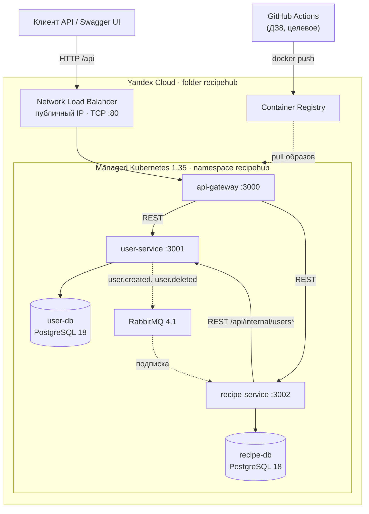
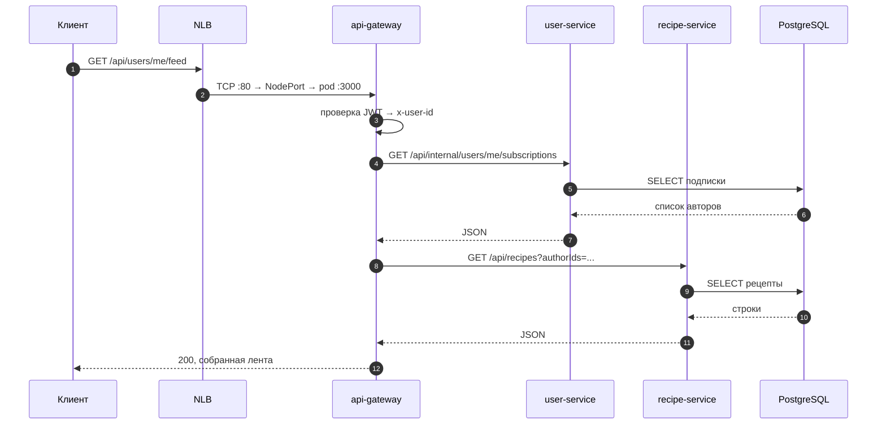
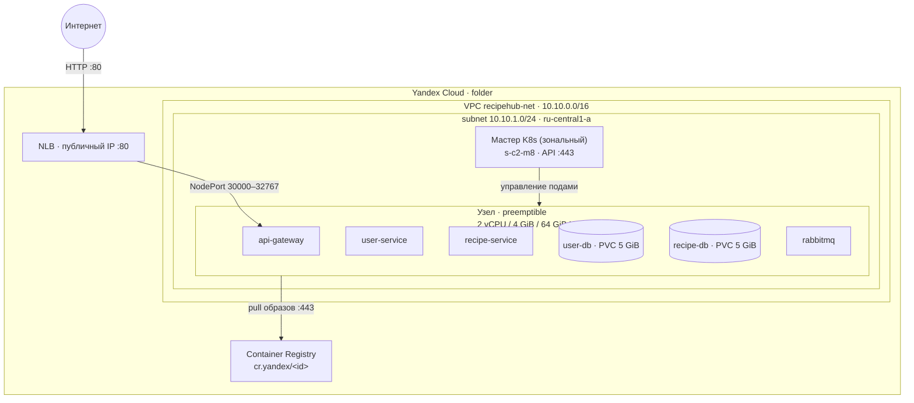
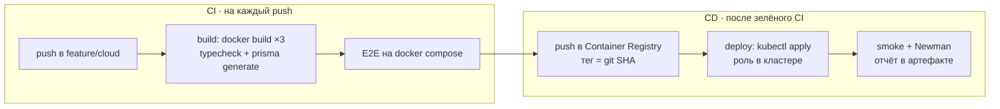

# Технический дизайн облачной инфраструктуры RecipeHub

**Дисциплина:** «Бэкенд-разработка», ИТМО, 4 курс, 7 семестр
**Работа:** ДЗ7 — технический дизайн облачной инфраструктуры для микросервисного веб-приложения
**Статус:** реализовано в ЛР7 (стенд поднимался, проверялся на живом кластере и погашен)
**Версия:** 1.0 · ноябрь 2026

---

## Кратко

- Приложение — три Node.js-микросервиса (`api-gateway`, `user`, `recipe`), две
  PostgreSQL и RabbitMQ; публичный вход один — `/api` через шлюз.
- Целевая платформа — **Yandex Managed Service for Kubernetes** (зональный мастер,
  Calico, версия 1.35), один прерываемый узел, `Service type=LoadBalancer`
  как точка входа, образы в Container Registry, вся инфраструктура — Terraform.
- Стенд **одноразовый**: `make up` → тесты/защита → `make down`. Пока он выключен,
  стоимость близка к нулю. Это осознанное архитектурное решение, а не упрощение
  «потому что не успели».
- Документ описывает **два состояния**: реализованный учебный стенд (основная
  часть) и production-вариант той же системы (раздел 11), чтобы было видно, какие
  решения приняты из-за бюджета, а какие — по существу задачи.
- Каждое утверждение проверяемо: в приложении A — таблица «пункт дизайна → файл
  в репозитории», в приложении B — инциденты, реально случившиеся при первом
  запуске, и то, как они изменили дизайн.

---

## 1. Контекст

### 1.1 Что за система

RecipeHub — сервис для обмена рецептами и кулинарных блогов. Пользователь
регистрируется, ведёт личный кабинет, публикует рецепты с пошаговыми инструкциями,
ищет рецепты с фильтрацией по типу блюда, сложности и ингредиентам, ставит оценки,
пишет комментарии, сохраняет чужие рецепты и подписывается на авторов. Лента
собирается из публикаций авторов, на которых подписан пользователь.

Функционально приложение готово (разделы 1–2 курса), в разделе 3 оно
разворачивалось на одной VPS с nginx, Ansible и мониторингом. Раздел 4 переносит
его в облако: управляемый Kubernetes, инфраструктура как код, CI/CD, документация,
нагрузочное тестирование.

### 1.2 Цели и ограничения

| Цель | Как проверяется |
|---|---|
| Развернуть приложение в облаке по воспроизводимому описанию | `terraform apply` + `make deploy` с нуля |
| Публичный доступ к API по HTTP | `curl http://<ip>/api/api-gateway-health` → 200 |
| Сохранить микросервисную структуру и все сценарии | 52 E2E-теста против облака |
| Не выйти за грант 4 000 ₽ / 60 дней | `make down` после каждой сессии, контроль биллинга |
| Заложить основу для ЛР8 (HPA, нагрузка) | Cluster Autoscaler включён с первого дня |

Ограничения, которые формируют дизайн:

1. **Бюджет.** Грант 4 000 ₽ на 60 дней. При ~10 ₽/час это ~400 часов работы
   стенда — с запасом на отладку, но не на «пусть работает месяц».
2. **Одна команда — один человек.** Нет дежурств, нет SRE, нет смысла в
   инфраструктуре, которую нельзя погасить одной командой.
3. **Данные не нужны между сессиями.** Стенд создаётся с пустыми БД, наполняется
   тестами и удаляется. Это снимает требование к бэкапам и персистентности.
4. **Нет домена и сертификата.** Доступ по IP, HTTP. Для учебной задачи этого
   достаточно; в production-варианте это первое, что меняется.
5. **Учебный, а не продуктовый масштаб.** Нагрузка — единицы RPS, а не сотни.

### 1.3 Требования

Функциональные требования совпадают с продуктовыми и здесь не дублируются.
Нефункциональные — ниже; колонка «стенд» описывает то, что реально реализовано,
колонка «prod» — целевое значение для боевой системы.

| Показатель | Стенд (реализовано) | Production (цель) | Комментарий |
|---|---|---|---|
| Доступность | ~99 % в период работы | 99,9 % в месяц | стенд живёт часами, а не месяцами |
| Latency p95, чтение | < 300 мс | < 200 мс | один узел, холодный кэш БД |
| Latency p95, запись | < 600 мс | < 400 мс | запись + событие в RabbitMQ |
| Error rate | < 1 % | < 0,1 % | 5xx / все ответы |
| Пропускная способность | 20–30 RPS | 200+ RPS | оценка по профилю нагрузки, раздел 2.4 |
| RTO (восстановление) | 20 мин (`make up` + `make deploy`) | 1 час | стенд пересоздаётся целиком |
| RPO (потеря данных) | не ограничен | 15 мин | на стенде данные не сохраняются |
| Время выката версии | 5 мин, с коротким перерывом | 10 мин, без перерыва | см. раздел 6.3 |
| Стоимость простоя | ≈ 0 ₽/час (`down`) | не применимо | главное требование к стенду |

### 1.4 Допущения

- Зона `ru-central1-a` доступна и в ней есть квоты на диски (после разового
  увеличения — см. раздел 10.4).
- Образы приложения собираются из этого же репозитория; сторонних образов только
  инфраструктурные (`postgres`, `rabbitmq`, `busybox`) с фиксированными тегами.
- Секреты стенда генерируются локально и живут в gitignored-файле; между сессиями
  они не меняются, чтобы не ломать подписанные JWT.
- CI/CD (ДЗ8) — следующий шаг; на момент написания этой версии документа жизненный
  цикл выполняется локально командами `make`.

---

## 2. Архитектура приложения

### 2.1 Контекст (C4, уровень 1)



Внешних систем, кроме GitHub (код и, в перспективе, CI), нет. Никаких платёжных
провайдеров, внешних очередей или хранилищ файлов — фото рецептов в текущей
реализации передаются ссылками, а не загружаются в приложение.

### 2.2 Контейнеры (C4, уровень 2)

| Компонент | Технология | Порт | Ответственность |
|---|---|---|---|
| `api-gateway` | Node.js, CommonJS, Express 5 | 3000 | единственная публичная точка; проверка JWT, инъекция `x-user-id` / `x-user-role`, маршрутизация на сервисы, композиция ленты `/users/me/feed`, Swagger UI `/api-docs`, `/openapi.json` |
| `user-service` | Node.js, ESM | 3001 | регистрация, вход, профиль, подписки, bootstrap администратора |
| `recipe-service` | Node.js, ESM | 3002 | рецепты, шаги, комментарии, оценки, сохранённые рецепты, поиск и фильтры |
| `user-db` | PostgreSQL 18.3 | 5432 | данные пользователей, подписок |
| `recipe-db` | PostgreSQL 18.3 | 5432 | рецепты, шаги, комментарии, оценки |
| `rabbitmq` | RabbitMQ 4.1 | 5672 | topic exchange `user-exchange`: каскадное удаление данных при удалении пользователя |

Ключевые архитектурные свойства, которые нельзя потерять при переносе в облако:

- **Только шлюз публичен.** Внутренние сервисы и БД не имеют внешних адресов.
  Внутренние ручки `/api/internal/*` не проксируются шлюзом и не должны быть
  доступны снаружи.
- **JWT проверяется один раз**, на шлюзе; сервисы доверяют заголовкам. Это
  упрощает код, но означает, что сетевой доступ к сервисам в обход шлюза —
  дыра в безопасности. Отсюда требования к изоляции (раздел 7.4).
- **Асинхронность best-effort.** Сервисы стартуют без RabbitMQ; события — не
  источник истины, а способ каскадно удалить данные. Поэтому в стенде RabbitMQ
  живёт без PVC (раздел 6.5).

### 2.3 Потоки данных

Синхронный путь (пример — лента пользователя):



Асинхронный путь: `user-service` публикует `user.created` / `user.deleted` в
`user-exchange`, `recipe-service` подписан и при удалении пользователя удаляет его
рецепты, комментарии и оценки. Доставка не гарантируется после перезапуска
RabbitMQ — это допустимо, потому что источник истины — PostgreSQL, а событие
лишь ускоряет каскад.

### 2.4 Профиль нагрузки и оценка мощности

Расчёт строится на запросах к подам, а не на «здравом смысле»:

| Под | requests CPU | requests RAM | limits CPU | limits RAM |
|---|---:|---:|---:|---:|
| `api-gateway` | 100m | 128 Mi | 500m | 256 Mi |
| `user-service` | 100m | 192 Mi | 500m | 384 Mi |
| `recipe-service` | 100m | 192 Mi | 500m | 384 Mi |
| `user-db` | 100m | 128 Mi | 500m | 384 Mi |
| `recipe-db` | 100m | 128 Mi | 500m | 384 Mi |
| `rabbitmq` | 100m | 192 Mi | 500m | 384 Mi |
| **Итого** | **600m** | **960 Mi** | **3000m** | **2176 Mi** |

Узел: 2 vCPU с гарантированной долей 50 % (то есть 1 vCPU гарантированно,
до 2 vCPU в burst), 4 GiB RAM. Allocatable после системных резервов kubelet —
примерно 1900m и 3,3 GiB.

Отсюда:

- **requests** занимают ~32 % CPU и ~29 % памяти узла — есть куда расти без
  немедленного добавления узлов;
- **limits** суммарно превышают allocatable (3000m против 1900m). Это нормальный
  overcommit: лимиты — потолок на случай всплеска, а не резервирование. При
  одновременном всплеске всех подов начнётся CPU throttling, а не OOM.
- По опыту раздела 3 и прогонов E2E фактическое потребление сервисов — десятки
  милливатт в покое; 20–30 RPS на такой конфигурации достигаются, что и будет
  измерено в ДЗ10/ЛР8.

Именно из этого расчёта выбран самый маленький узел: 2 vCPU / 4 GiB. Меньше —
не хватит на requests шести подов; больше — платим за простой.

---

## 3. Архитектура облачной инфраструктуры

### 3.1 Общая схема



Одна зона, одна подсеть, один узел — всё это следствия требования «стенд должен
стоить ~0 ₽ в выключенном состоянии и ~10 ₽/час во включённом». Как это
масштабируется до production, описано в разделе 11.

### 3.2 Ресурсы

| Ресурс | Имя | Конфигурация | Зачем |
|---|---|---|---|
| VPC | `recipehub-net` | 10.10.0.0/16 | своя сеть, удаляется целиком при `destroy` |
| Подсеть | `recipehub-subnet-ru-central1-a` | 10.10.1.0/24 | узлы и мастер |
| Security group | `recipehub-k8s` | служебный трафик кластера | мастер ↔ узлы, healthcheck балансировщика |
| Security group | `recipehub-master` | 443/6443 снаружи | доступ к Kubernetes API |
| Security group | `recipehub-nodes` | поды, сервисы, NodePort | трафик приложения |
| Сервисный аккаунт | `recipehub-k8s-res` | `k8s.clusters.agent`, `vpc.publicAdmin`, `load-balancer.admin` | облако создаёт узлы, диски и NLB от его имени |
| Сервисный аккаунт | `recipehub-k8s-node` | `container-registry.images.puller` | узлы тянут образы |
| Кластер | `recipehub-cloud` | зональный, 1.35, Calico, публичный API | оркестрация |
| Группа узлов | `recipehub-cloud-nodes` | 1 × preemptible 2 vCPU / 4 GiB, диск 64 GiB HDD, autoscale 1–2 | вычисления |
| Container Registry | `recipehub-registry` | 3 образа, ~270 МБ каждый | хранение образов |
| NLB | создаётся контроллером | публичный, TCP :80 | точка входа |
| PVC | `data-user-db`, `data-recipe-db` | 5 GiB `yc-network-ssd` каждая | данные PostgreSQL |

Все ресурсы помечены метками `project=recipehub`, `environment=study`,
`managed_by=terraform` — это позволяет видеть стенд в разрезе по проекту в
биллинге и не путать его с другими ресурсами каталога.

### 3.3 Границы ответственности

| Слой | Кто отвечает | Комментарий |
|---|---|---|
| Физические хосты, сеть, диски | Yandex Cloud | IaaS |
| Control plane Kubernetes, etcd, API | Yandex Cloud (managed) | обновления мастера — на стороне облака, автоподъём выключен политикой |
| kubelet, container runtime, ОС узла | Yandex Cloud (образ) + мы (версия, размер) | узлы пересоздаются автоматически при отказе |
| Namespace, Deployment, StatefulSet, Service, Secret, ConfigMap | мы | всё в `deploy/cloud/k8s/` |
| Приложение и его данные | мы | образы, миграции Prisma, бэкапы — наша зона |

Такое разделение — главный аргумент в пользу managed Kubernetes: мы не
администрируем etcd и не чиним control plane, а платим за это фиксированную
ставку за мастер.

### 3.4 Инфраструктура как код

Terraform, провайдер `yandex-cloud/yandex`, state локальный (в git не попадает).
Структура:

| Файл | Содержимое |
|---|---|
| `versions.tf` | версии Terraform и провайдера |
| `providers.tf` | подключение к каталогу и зоне |
| `variables.tf` | все параметры с дефолтами и комментариями |
| `main.tf` | локальные значения, метки |
| `network.tf` | сеть, подсеть, три security group |
| `iam.tf` | сервисные аккаунты и роли |
| `kubernetes.tf` | кластер и группа узлов |
| `registry.tf` | реестр образов |
| `outputs.tf` | id кластера, реестра, сети; endpoint API |

Манифесты Kubernetes — плоские YAML с плейсхолдерами `__REGISTRY__` и `__TAG__`;
`scripts/deploy.sh` подставляет реальные значения в `.rendered/` (каталог в
`.gitignore`) и применяет. Helm и Kustomize сознательно не используются: для
шести манифестов и одного окружения они добавляют больше сложности, чем убирают.

---

## 4. Облачные ресурсы: обоснование

### 4.1 Мастер

- **Зональный, а не региональный.** Региональный мастер — это три инстанса
  control plane в трёх зонах, то есть втрое дороже (раздел 11). Для стенда,
  который живёт часы, отказ зоны означает «пересоздать», а не «переключиться».
- **Конфигурация `s-c2-m8`** — минимально доступная. Меньших пресетов у
  managed-кластера нет, поэтому это нижняя граница стоимости, а не выбор.
- **Публичный API** (`public_ip = true`) — чтобы `kubectl` работал с ноутбука без
  VPN и бастиона. Доступ всё равно требует IAM-аутентификации; список
  разрешённых сетей задаётся переменной `admin_cidrs` и по умолчанию открыт
  (0.0.0.0/0) — осознанный компромисс, в production сужается до офиса/VPN.
- **Автообновление выключено.** Стенд живёт часами; внезапный апгрейд мастера во
  время демонстрации не нужен. Версия фиксируется переменной `k8s_version`
  (1.35) и поднимается вручную между сессиями.

### 4.2 Узлы

- **Один узел.** Все шесть подов помещаются с запасом (раздел 2.4). Второй узел
  дал бы отказоустойчивость, но удвоил бы стоимость вычислений при нагрузке
  «один пользователь и E2E-тесты».
- **Прерываемые (preemptible).** Дешевле примерно вдвое; облако может остановить
  такую ВМ раз в 24 часа. Для стенда это приемлемо: поды переедут, а в худшем
  случае стенд пересоздаётся за 20 минут. В production прерываемые узлы
  допустимы только для batch-нагрузки, не для API.
- **2 vCPU с долей 50 %.** Гарантированные 1 vCPU покрывают requests (600m) с
  запасом, burst до 2 vCPU — на пики и сборку. Полные 100 % стоили бы дороже
  вдвое без пользы для учебной нагрузки.
- **Диск 64 GiB HDD.** Меньше нельзя: 64 GiB — минимум для загрузочного диска
  узла managed-кластера. HDD дешевле SSD, а скорость диска узла не является
  узким местом (данные лежат на сетевых SSD в PVC).
- **Cluster Autoscaler 1–2** включён сразу. Причина прагматичная: тип
  масштабирования нельзя изменить после создания группы, а автоскейлинг
  понадобится в ЛР8. Второй узел появится только под нагрузкой.

### 4.3 Реестр образов

Один реестр на три образа. Тег — короткий git SHA (плюс `-dirty`, если рабочее
дерево грязное), что даёт однозначную связь «работающий под ↔ коммит». Реестр
приватный: узлы тянут образы от имени сервисного аккаунта с ролью
`container-registry.images.puller`, у остальных доступа нет. Стоимость хранения
~270 МБ × 3 — копейки, поэтому реестр живёт между сессиями и позволяет не
пересобирать образы при каждом `make up`.

### 4.4 Балансировщик

`Service type=LoadBalancer` для `api-gateway` — контроллер облака сам создаёт
сетевой балансировщик с публичным IP и настраивает healthcheck на NodePort.

Почему не ingress-контроллер и не Application Load Balancer:

- ingress-nginx — это ещё один Deployment, Service, ConfigMap и точка отказа на
  одном узле; для одного хоста и одного пути `/api` он ничего не даёт;
- ALB умеет TLS, маршрутизацию по путям и WAF, но стоит дороже NLB и требует
  домена и сертификата, которых у стенда нет.

NLB работает на L4: он не терминирует TLS и не разбирает HTTP — просто передаёт
TCP на NodePort узла. Для HTTP по IP этого достаточно.

### 4.5 IAM

Два сервисных аккаунта с минимальными ролями:

| Аккаунт | Роль | Зачем |
|---|---|---|
| `recipehub-k8s-res` | `k8s.clusters.agent` | создание узлов, дисков, групп |
| | `vpc.publicAdmin` | публичные IP узлов и NLB |
| | `load-balancer.admin` | NLB для `Service type=LoadBalancer` |
| `recipehub-k8s-node` | `container-registry.images.puller` | pull образов |

Роли назначены на каталог, а не на облако — принцип минимальных привилегий в
рамках учебного каталога. Пользовательские права (кто может `kubectl`) не
выдаются через IAM вообще: доступ к API идёт от аккаунта владельца каталога,
а внутри кластера RBAC остаётся дефолтным.

### 4.6 Что сознательно не создаётся

| Ресурс | Почему нет | Когда появится |
|---|---|---|
| Managed PostgreSQL | ~2 500–4 000 ₽/мес за HA-инстанс против ~150 ₽/мес за PVC; данные всё равно не переживают `down` | production (раздел 11) |
| Managed RabbitMQ | то же, плюс события не являются источником истины | production |
| NAT-шлюз | у узла есть публичный IP, исходящий трафик идёт напрямую; NAT стоит денег и нужен для приватных подсетей | production |
| ALB + TLS | нет домена; HTTP по IP достаточно | production |
| Lockbox | секретов пять, они живут в gitignored-файле и в Kubernetes Secret | production |
| Managed Prometheus / логирование | для стенда хватает `kubectl top`, `kubectl logs` и health-эндпоинтов | ЛР8, production |
| Object Storage | приложение не хранит файлы | при появлении загрузки фото |
| DNS-зона | доступ по IP | production |

Каждая строка этой таблицы — сознательный выбор в пользу бюджета, а не
незнание возможностей платформы.

---

## 5. Сетевая связность

### 5.1 Адресация

| Назначение | CIDR | Комментарий |
|---|---|---|
| VPC | `10.10.0.0/16` | своя сеть, не пересекается с default |
| Подсеть (узлы, мастер) | `10.10.1.0/24` | одна зона |
| Поды | `10.96.0.0/16` | Calico, маска на узел /24 |
| Сервисы (ClusterIP) | `10.112.0.0/16` | виртуальные адреса, не пересекаются с подами |
| Kubernetes API | публичный endpoint | 443/6443, IAM-аутентификация |
| Внешний вход приложения | публичный IP NLB | динамический, выдаётся при создании Service |

Диапазоны выбраны так, чтобы не пересекаться ни между собой, ни с типовыми
домашними и корпоративными сетями (`10.0.0.0/8` берётся не целиком, а узкими
блоками) — иначе возможны проблемы при подключении VPN в production.

### 5.2 Security groups

Три группы, разделённые по роли, а не одна «на всё»:

**`recipehub-k8s`** — служебный трафик кластера:

| Направление | Источник/назначение | Протокол/порт | Зачем |
|---|---|---|---|
| ingress | `loadbalancer_healthchecks` | TCP | healthcheck NLB |
| ingress | own security group | any | мастер ↔ узлы, поды ↔ поды |
| ingress | 10.0.0.0/8, 172.16.0.0/12, 192.168.0.0/16 | ICMP | диагностика связности |
| egress | own security group | any | обратный трафик |
| egress | 10.96.0.0/16 | any | мастер → поды (webhooks, metrics) |

**`recipehub-master`** — доступ к API:

| Направление | Источник/назначение | Протокол/порт | Зачем |
|---|---|---|---|
| ingress | `admin_cidrs` (по умолчанию 0.0.0.0/0) | TCP 443, 6443 | `kubectl`, `yc` |
| egress | 10.96.0.0/16 | TCP 4443 | мастер → metrics-server |
| egress | 0.0.0.0/0 | UDP 123 | синхронизация времени |

**`recipehub-nodes`** — трафик приложения:

| Направление | Источник/назначение | Протокол/порт | Зачем |
|---|---|---|---|
| ingress | 10.96.0.0/16, 10.112.0.0/16 | any | поды и сервисы внутри кластера |
| ingress | 0.0.0.0/0 | TCP 30000–32767 | NodePort для NLB |
| egress | 0.0.0.0/0 | any | pull образов, NTP, обновления |

Правило NodePort открыто всему интернету — это упрощение. В production оно
сужается до адресов балансировщика (или заменяется на `loadbalancer_healthchecks`
плюс внутренний трафик), но для стенда без статического IP NLB это лишняя
сложность: попасть на NodePort можно только зная адрес узла, а сам узел за
балансировщиком не публикуется в DNS.

### 5.3 Потоки трафика

| # | Источник | Назначение | Порт | Разрешено правилом |
|---|---|---|---|---|
| 1 | Интернет | NLB | 80/TCP | публичный ресурс облака |
| 2 | NLB | узел (NodePort) | 3xxxx/TCP | `nodes`: 30000–32767 |
| 3 | NLB (healthcheck) | узел | NodePort | `k8s`: `loadbalancer_healthchecks` |
| 4 | `api-gateway` | `user-service` | 3001 | `nodes`: поды ↔ сервисы |
| 5 | `api-gateway` | `recipe-service` | 3002 | `nodes`: поды ↔ сервисы |
| 6 | `recipe-service` | `user-service` (`/api/internal/users*`) | 3001 | `nodes`: поды ↔ сервисы |
| 7 | `user-service` | `user-db` | 5432 | `nodes`: поды ↔ сервисы |
| 8 | `recipe-service` | `recipe-db` | 5432 | `nodes`: поды ↔ сервисы |
| 9 | `user-service`, `recipe-service` | `rabbitmq` | 5672 | `nodes`: поды ↔ сервисы |
| 10 | узел | `cr.yandex` | 443/TCP | `nodes`: egress 0.0.0.0/0 |
| 11 | администратор | мастер | 443, 6443 | `master`: `admin_cidrs` |
| 12 | мастер | поды (webhooks, metrics) | 443, 4443 | `k8s`/`master`: cluster CIDR |
| 13 | мастер | NTP | 123/UDP | `master`: egress |

Внутренние имена (`user-service`, `recipe-db`, `rabbitmq`) — это ClusterIP-сервисы
Kubernetes: DNS-запись `<service>.<namespace>.svc.cluster.local` резолвится
внутри подов через CoreDNS, поэтому приложение не знает IP-адресов.

### 5.4 DNS и TLS

- **DNS снаружи:** нет. Клиент ходит на IP балансировщика; IP меняется при
  пересоздании стенда, актуальный выдаёт `make url`.
- **DNS внутри:** CoreDNS из состава managed-кластера, ничего настраивать не нужно.
- **TLS:** отсутствует. Трафик от клиента до NLB идёт открытым HTTP. Это
  задокументированный риск: в production первым шагом появляются домен, ACME-
  сертификат и терминация на ALB (раздел 11).
- **JWT** передаётся в заголовке `Authorization`; по открытому каналу его можно
  перехватить — ещё одна причина, почему HTTP допустим только для учебного
  стенда без реальных пользовательских данных.

### 5.5 Egress

Узел имеет публичный IP, поэтому исходящий трафик (pull образов, NTP, при
необходимости — внешние API) идёт напрямую через NAT облака, без NAT-шлюза в
нашей сети. Это дешевле и проще, но означает, что узел одновременно публичный и
исходящий — компромисс, приемлемый для одноразового стенда.

### 5.6 NetworkPolicy

Calico включён на уровне кластера (`network_policy_provider = CALICO`), но
политики не применяются: в namespace один tenant, все поды — наши. В production
первым делом добавляется default-deny и точечные разрешения (раздел 11), иначе
любой скомпрометированный под может обратиться к БД напрямую.

---

## 6. Отказоустойчивость и масштабирование

### 6.1 Домены отказов

| Уровень | Что отказывает | Изоляция |
|---|---|---|
| Контейнер | процесс, OOM, исключение | kubelet перезапускает, пробы выводят под из балансировки |
| Под | eviction, неудачный rollout | Deployment/StatefulSet создаёт замену |
| Узел | отказ ВМ, остановка preemptible | поды переезжают на другой узел, если он есть |
| Зона | отказ ЦОД | стенд недоступен целиком (одна зона) |
| Мастер | отказ control plane | managed-сервис восстанавливает сам, данные в etcd реплицированы облаком |
| Данные | потеря пода БД | PVC на сетевом SSD переживает рестарт пода |
| Данные | удаление PVC / `make down` | потеря безвозвратная (принято) |
| Внешний сервис | недоступность реестра образов | работающие поды живут, новые не стартуют |

### 6.2 Матрица отказов

| Отказ | Что происходит | Влияние на пользователя | Восстановление | RTO |
|---|---|---|---|---|
| Падение контейнера | kubelet перезапускает по политике `Always` | 5–30 с ошибок, если под был единственным | автоматически | ~30 с |
| Под не проходит readiness | исключается из endpoints Service | запросы идут на другие поды; при одной реплике — 503 | автоматически после восстановления | зависит от причины |
| Остановка preemptible-узла | поды evicted, Cluster Autoscaler поднимает новый узел | полный простой до появления узла | автоматически | 3–10 мин |
| Отказ зоны `ru-central1-a` | недоступны мастер и узел | полный простой | пересоздание стенда | ~20 мин |
| Отказ мастера | API недоступен, поды продолжают работать, NLB балансирует | API приложения работает, управление — нет | силами облака | зависит от облака |
| Рестарт пода БД | StatefulSet перезапускает, PVC монтируется заново | 10–60 с ошибок БД | автоматически | ~1 мин |
| Потеря PVC/диска | данные БД утеряны | требуется повторная инициализация | `make down && make up` | ~20 мин |
| Неудачный деплой | новые поды не проходят readiness, старые уже удалены | простой до отката | `kubectl rollout undo` | ~5 мин |
| Исчерпание квоты | `terraform apply` падает на создании группы узлов | стенд не поднимается | запрос квоты, повтор | часы (ручное) |
| Недоступен реестр | новые поды в ImagePullBackOff | работающие поды не затронуты | ждать/повторить | — |

Две строки здесь — не теория, а пережитые инциденты: исчерпание квоты на диски и
неудачный rollout из-за таймаута readiness RabbitMQ. Подробности — приложение B.

### 6.3 Пробы и жизненный цикл подов

| Компонент | Readiness | Liveness | Особенность |
|---|---|---|---|
| `api-gateway` | HTTP `/api/api-gateway-health`, 5 с / 5 с | то же, 30 с / 20 с | стартует быстро, зависимостей нет |
| `user-service` | HTTP `/api/user-service-health`, 10 с / 5 с | 60 с / 20 с | ждёт БД через initContainer |
| `recipe-service` | HTTP `/api/recipe-service-health`, 10 с / 5 с | 60 с / 20 с | ждёт БД через initContainer |
| `user-db`, `recipe-db` | `pg_isready`, 5 с / 5 с | 30 с / 20 с | liveness мягче, чтобы не убивать БД при долгом старте |
| `rabbitmq` | `rabbitmq-diagnostics check_port_connectivity`, таймаут 15 с, 6 попыток | — | дефолтная секунда не укладывается, см. приложение B |

`initContainer` `wait-for-db` (busybox, `nc -z`) решает проблему порядка запуска:
под сервиса не начинает стартовать, пока БД не принимает соединения. Это дешевле
и надёжнее, чем ретраи Prisma на старте.

**Про деплой на одном узле.** Политика группы узлов `max_expansion = 0`,
`max_unavailable = 1`: новый узел под обновление не создаётся (иначе платим за
второй). При одной реплике сервиса это означает короткий перерыв в обслуживании
на время замены пода — 5–20 секунд. Для стенда приемлемо; в production нужны
`maxSurge > 0`, минимум две реплики и PodDisruptionBudget (раздел 11).

### 6.4 Масштабирование

- **Cluster Autoscaler** (уровень узлов): 1–2 узла. Второй добавляется, когда поды
  не помещаются по requests. Это задел под ЛР8: HPA увеличит число реплик, а
  узлов станет больше автоматически.
- **HPA** (уровень подов) пока не настроен — по заданию он относится к ЛР8.
  Дизайн к нему готов: у всех подов заданы requests (без них HPA не работает),
  в кластере есть metrics-server.
- **Ручное масштабирование** сейчас: изменить `replicas` в манифесте. Для
  состояния гонки нет — сервисы stateless, кроме БД, которые масштабировать
  репликами нельзя без репликации.

### 6.5 Данные: персистентность, бэкапы, DR

| Данные | Хранение | Переживает рестарт пода | Переживает `make down` | Бэкапы |
|---|---|---|---|---|
| PostgreSQL (2 БД) | PVC `yc-network-ssd` 5 GiB | да | **нет** | нет (осознанно) |
| RabbitMQ | слой контейнера (без PVC) | нет | нет | не нужны |
| Образы | Container Registry | да | нет (удаляются при `down`) | не нужны, пересобираются из git |
| Секреты | локальный `.secrets.env` + Secret | да | нет | файл на ноутбуке |

RPO стенда формально бесконечен: любая потеря диска означает потерю данных. Это
приемлемо, потому что данные создаются тестами и не имеют ценности. Для
production RPO задаётся 15 минут и обеспечивается PITR managed-кластера
PostgreSQL с хранением WAL и ежедневными полными бэкапами (раздел 11).

DR-план стенда — это не «восстановление из бэкапа», а «пересоздание с нуля»:
`make down` → `make up` → `make build` → `make deploy`. Время — около 20 минут,
из них 10–15 занимает создание кластера.

### 6.6 Сводка RTO/RPO

| Сценарий | Стенд | Production |
|---|---|---|
| Отказ пода | 30 с | 30 с (при ≥2 репликах — без простоя) |
| Отказ узла | 3–10 мин | 1–2 мин (поды уже на других узлах) |
| Отказ зоны | 20 мин (пересоздание) | без простоя (3 зоны) |
| Отказ мастера | на усмотрение облака | без простоя (региональный мастер) |
| Потеря данных | RPO не ограничен | RPO 15 мин, RTO 1 ч |
| Ошибочный деплой | 5 мин (откат) | 10 мин (откат, без простоя) |

---

## 7. Безопасность

### 7.1 Модель угроз (кратко)

Для учебного стенда значимы четыре угрозы:

1. **Утечка секретов через git.** Пароли БД, JWT-ключ и пароль администратора не
   должны попадать в репозиторий и в образы.
2. **Обход шлюза.** Если внутренние сервисы доступны снаружи, можно подделать
   `x-user-id` и действовать от чужого имени.
3. **Компрометация узла.** Публичный IP и открытый egress означают, что узел
   виден из интернета; скомпрометированный под может дойти до БД.
4. **Случайное уничтожение или утечка денег.** `terraform destroy` без
   подтверждения, забытый кластер, случайный `apply` из CI.

### 7.2 IAM

- Отдельные сервисные аккаунты для ресурсов кластера и для узлов; роли — только
  необходимые (раздел 4.5).
- Ключи сервисных аккаунтов не создаются: Terraform и `yc` используют IAM-токен
  пользователя, полученный через `yc iam create-token` (живёт 12 часов).
- Доступ к API кластера — только аутентифицированный IAM; внутри кластера RBAC
  дефолтный, дополнительных пользователей нет.

### 7.3 Секреты

| Секрет | Где создаётся | Где используется | Ротация |
|---|---|---|---|
| `JWT_SECRET` | `openssl rand -hex 32` в `.secrets.env` | все три сервиса | при пересоздании стенда вручную |
| `USER_DB_PASSWORD`, `RECIPE_DB_PASSWORD` | `openssl rand -hex 16` | соответствующие БД и сервисы | то же |
| `RABBITMQ_PASSWORD` | `openssl rand -hex 16` | RabbitMQ, `user-service`, `recipe-service` | то же |
| `ADMIN_PASSWORD` | `openssl rand -hex 12` | bootstrap администратора | то же |

Все они попадают в Kubernetes Secret `recipehub-secrets` и монтируются в поды как
переменные окружения. Файл `.secrets.env` в `.gitignore`, права `600`.
Ограничение: Secret в Kubernetes хранится в etcd в base64 и не шифруется
автоматически — в production для этого используется KMS/Lockbox (раздел 11).

### 7.4 Сетевая изоляция

- Публично доступен только NLB → `api-gateway`. БД и внутренние сервисы —
  ClusterIP, снаружи недоступны.
- `/api/internal/*` не проксируется шлюзом: даже пройдя на шлюз, клиент не
  достанет внутренние ручки.
- Security groups разделены по роли (раздел 5.2), а не «одна на всё».
- Чего не хватает: NetworkPolicy (раздел 5.6) и сужения NodePort. Оба пункта — в
  плане production.

### 7.5 Безопасность приложения

- JWT проверяется только шлюзом; сервисы доверяют `x-user-id` / `x-user-role`.
  Поэтому критично, что они не опубликованы.
- Пароли хранятся как bcrypt-хэши, вход — по логину и паролю.
- Администратор создаётся при старте `user-service` из `ADMIN_USERNAME` /
  `ADMIN_PASSWORD`; пароль не дефолтный, а сгенерированный (в разделе 3 на VPS
  был `admin123` — это исправлено).
- Zod-схемы валидируют все запросы и ответы; ошибки отдаются как `{ error }` без
  внутренних деталей и стектрейсов.

### 7.6 Supply chain

- Образы собираются из этого репозитория по `Dockerfile` каждого сервиса;
  базовые образы фиксированы по тегам (`postgres:18.3-alpine`,
  `rabbitmq:4.1-management-alpine`, `busybox:1.37`).
- Реестр приватный, push требует IAM-токена, pull — роль сервисного аккаунта.
- Тег образа — git SHA, поэтому по работающему поду всегда можно найти коммит.
- Чего не хватает: сканирования уязвимостей образов и подписи (cosign).
  Кандидат на production.

### 7.7 Остаточные риски стенда

| Риск | Почему принят | Как закрывается в production |
|---|---|---|
| HTTP без TLS | нет домена, учебные данные | ALB + ACME |
| Публичный API кластера | удобство `kubectl` | `admin_cidrs`, VPN, приватный endpoint |
| Нет NetworkPolicy | один tenant | default-deny + allow-list |
| Secret не шифрован в etcd | нет KMS | Lockbox + KMS |
| NodePort открыт всем | нет статического IP NLB | сужение до адресов NLB |
| Один узел | цена | ≥2 узлов в ≥2 зонах |
| Нет сканирования образов | объём работ | Trivy в CI |

---

## 8. Наблюдаемость

### 8.1 Что есть на стенде

| Инструмент | Что даёт | Стоимость |
|---|---|---|
| `kubectl get pods / top / describe` | состояние, потребление, события | 0 |
| `kubectl logs` | логи подов (stdout) | 0 |
| health-эндпоинты `/api/<service>-health` | готовность каждого сервиса | 0 |
| `make smoke` | health всех сервисов + Swagger UI | 0 |
| `make test` | 52 E2E-теста, проверяют сценарии целиком | 0 |
| `kubectl rollout status` | результат деплоя | 0 |
| metrics-server (в составе managed) | CPU/RAM подов, основа для HPA | 0 |

Для стенда, который живёт часы и проверяется сразу после деплоя, этого
достаточно: метрики нужны не для дежурства, а для отладки здесь и сейчас.

### 8.2 Что нужно в production

| Сигнал | Инструмент | Зачем |
|---|---|---|
| Метрики подов и узлов | Managed Prometheus + Grafana | SLO, HPA, capacity planning |
| Логи | Loki или Managed Logging | разбор инцидентов, аудит |
| Трейсы | OpenTelemetry + Tempo/Jaeger | поиск узких мест в цепочке шлюз → сервис → БД |
| Ошибки приложения | Sentry | исключения с контекстом |
| Алерты | Alertmanager → Telegram | дежурство |
| Аудит API Kubernetes | Audit Trails | кто что менял |

### 8.3 SLO и алерты

Целевые SLO — в разделе 1.3. Алерты, которые будут настроены в ЛР8:

| Алерт | Условие | Реакция |
|---|---|---|
| Высокая ошибка | 5xx > 1 % за 5 мин | откат или разбор логов |
| Высокая latency | p95 > 1 с за 5 мин | проверка CPU/throttling |
| Под не готов | `Ready` = 0 > 2 мин | `describe`, события |
| Узел не готов | `NotReady` > 5 мин | проверка квот и событий |
| Переполнение диска | PVC > 80 % | чистка, расширение |

---

## 9. CI/CD

### 9.1 Текущее состояние

Жизненный цикл выполняется локально из `deploy/cloud`:

```text
make up      → terraform init/apply, kubeconfig, ожидание Ready узлов
make build   → docker build ×3, docker login cr.yandex, docker push
make deploy  → Secret + ConfigMap, рендер манифестов, kubectl apply, rollout status
make smoke   → health всех сервисов, Swagger UI
make test    → smoke + 52 E2E-теста
make down    → удаление namespace (NLB, PVC), образов, terraform destroy
```

Так сделано намеренно: на этом этапе важно было отладить инфраструктуру и
манифесты, а не автоматизировать их запуск. Плюс ручного контура — невозможно
случайно создать платный кластер из push в ветку.

### 9.2 Целевой пайплайн (ДЗ8)



Требования к пайплайну, вытекающие из этого дизайна:

- **Деплой только из CI**, тег образа = SHA коммита, чтобы откат был
  `kubectl rollout undo` или повторный деплой предыдущего тега.
- **Тесты до деплоя**, а не после: E2E на `docker compose` дешевле и быстрее, чем
  прогон против облака, а облако нужно только для проверки «оно там работает».
- **Аутентификация** — сервисный аккаунт с ключом в GitHub Secrets (или workload
  identity federation, если она доступна в каталоге); IAM-токен живёт 12 часов,
  для пайплайна достаточно.
- **Смоук после деплоя** — health + Swagger + ключевой сценарий (регистрация,
  создание рецепта, лента).

### 9.3 Контур Terraform

Инфраструктура не должна меняться по push. Отдельный workflow:

| Триггер | Действие |
|---|---|
| `workflow_dispatch` с параметром `action=plan` | `terraform plan`, план в артефакт и в summary |
| `workflow_dispatch` с `action=apply` | только после подтверждения через GitHub Environment с required reviewer |
| `workflow_dispatch` с `action=destroy` | подтверждение, удаление стенда |
| push | ничего |

Это прямое следствие цены ошибки: забытый кластер — это ~7 200 ₽/мес, то есть
грант целиком за две недели.

### 9.4 Секреты в CI

| Секрет | Назначение |
|---|---|
| `YC_SA_KEY` | JSON-ключ сервисного аккаунта для `yc` и `terraform` |
| `YC_CLOUD_ID`, `YC_FOLDER_ID` | параметры каталога |
| `KUBE_CONFIG` | доступ к кластеру для деплоя (или генерация через `yc`) |
| `JWT_SECRET`, `*_DB_PASSWORD`, `RABBITMQ_PASSWORD`, `ADMIN_PASSWORD` | значения для Kubernetes Secret |

Правило: значения секретов не печатаются в логах, `terraform plan` не содержит
паролей (они передаются в кластер через `kubectl create secret`, а не через
Terraform).

---

## 10. Стоимость и контроль бюджета

### 10.1 Стенд

Тарифы Yandex Cloud на момент написания; точные суммы — в калькуляторе и биллинге.

| Ресурс | Конфигурация | ₽/час |
|---|---|---:|
| Мастер Managed K8s | зональный, 2 vCPU / 8 GiB | 7,20 |
| Worker | 1 × preemptible, 2 vCPU (50 %), 4 GiB | 0,82 |
| Загрузочный диск | 64 GiB HDD | 0,31 |
| Публичный IP узла | динамический | 0,26 |
| NLB | публичный, TCP :80 | 0,92 |
| Публичный IP NLB | динамический | 0,26 |
| PVC | 2 × 5 GiB SSD | 0,20 |
| Container Registry | ~1 ГБ образов | ~0,01 |
| **Итого** | | **~10 ₽/час** |

Доля мастера — 70 % стоимости. Именно поэтому «остановить кластер» (`pause`)
экономит почти всё: мастер и узлы не тарифицируются, остаются диски, IP и
балансировщик — около 2 ₽/час.

### 10.2 Сценарии

| Сценарий | Время | Стоимость |
|---|---|---:|
| Полный цикл: up → build → deploy → тесты → down | 1,5–2 ч | 15–20 ₽ |
| Отладка одного сервиса (стенд уже поднят) | 1 ч | ~10 ₽ |
| Демонстрация на защите | 30 мин | ~5 ₽ |
| `pause` на ночь | 12 ч | ~24 ₽ |
| Забыть на сутки | 24 ч | ~240 ₽ |
| Забыть на месяц | 720 ч | ~7 200 ₽ |

Грант 4 000 ₽ при таком режиме покрывает ~400 часов работы стенда — с большим
запасом на все работы раздела 4, включая нагрузочные тесты в ЛР8.

### 10.3 Production-вариант

Оценка порядка величины для отказоустойчивой конфигурации из раздела 11
(не биллинг, а ориентир для сравнения):

| Компонент | Конфигурация | ₽/час |
|---|---|---:|
| Региональный мастер | 3 × s-c2-m8 | ~21,6 |
| Узлы | 6 × (2 vCPU 100 %, 4 GiB) в трёх зонах | ~32 |
| Managed PostgreSQL HA | 2 хоста, 2 vCPU / 8 GiB, 100 GiB SSD, PITR | ~25–35 |
| ALB + TLS | публичный, ACME | ~2–3 |
| NAT-шлюз | для приватных подсетей | ~1 |
| Object Storage | 50 GiB + CDN | ~0,5 |
| Managed Prometheus + логи | базовый объём | ~3–5 |
| Registry, DNS, Lockbox | — | ~0,5 |
| **Итого** | | **~85–100 ₽/час ≈ 60–75 тыс. ₽/мес** |

При круглосуточной работе разница со стендом — примерно в 9 раз (7 200 ₽ против
65 000 ₽ в месяц), а при реальном режиме стенда (несколько часов в неделю,
~100 ₽/мес) — в сотни раз. Именно поэтому production-конфигурация описана, но не
развёрнута: учебная задача не требует 99,9 % доступности, а грант — нет.

### 10.4 Контроль бюджета

1. **`make down` после каждой сессии** — не «когда-нибудь», а сразу. `down.sh`
   удаляет namespace (вместе с NLB и PVC), чистит образы, делает
   `terraform destroy` и проверяет остатки: кластеры, балансировщики, адреса,
   диски.
2. **`make status`** перед уходом — показывает, что создано и нет ли «сирот».
3. **Бюджетный алерт** в Yandex Cloud Billing на 300–500 ₽/мес.
4. **Метки ресурсов** (`project`, `environment`, `managed_by`) — расходы видны в
   разрезе проекта.
5. **Никакого `apply` из CI** без ручного подтверждения (раздел 9.3).
6. **Квоты как предохранитель.** После разового увеличения HDD до 100 GiB и SSD
   до 20 GiB в зоне `ru-central1-a` квота не даст случайно создать много узлов:
   два узла по 64 GiB уже упираются в лимит. Это неудобно при масштабировании,
   но полезно для контроля расходов.

---

## 11. Production-вариант: как это выглядело бы в проде

Стенд упрощён по бюджету. Ниже — та же система, спроектированная без ограничения
«10 ₽/час». Таблица показывает, что именно меняется и зачем.

### 11.1 Дельта конфигурации

| Компонент | Стенд | Production | Зачем |
|---|---|---|---|
| Мастер | зональный, 1 зона | региональный, 3 зоны | отказ зоны не останавливает управление |
| Узлы | 1 × preemptible | 6 × (2 в каждой зоне), обычные, 4–8 vCPU | отказ зоны и узла без простоя |
| Реплики сервисов | 1 | 2–3 + HPA | нет простоя при деплое и отказе |
| PostgreSQL | StatefulSet в кластере | Managed PostgreSQL HA, 2 хоста, PITR | RPO 15 мин, RTO 1 ч |
| RabbitMQ | Deployment без PVC | Managed RabbitMQ или кластер из 3 нод | сохранность событий, HA |
| Вход | NLB на Service | ALB + Ingress + TLS (ACME) | HTTPS, маршрутизация, WAF |
| DNS | IP | зона `recipehub.example` + записи | стабильный адрес |
| Секреты | Kubernetes Secret | Lockbox + KMS | шифрование, аудит, ротация |
| Изоляция | security groups | + NetworkPolicy default-deny | защита от lateral movement |
| Egress | публичный IP узла | NAT-шлюз, приватные узлы | узлы не видны из интернета |
| Мониторинг | `kubectl` | Managed Prometheus, Grafana, Loki, Sentry, алерты | дежурство и SLO |
| Бэкапы | нет | ежедневные + WAL, проверка восстановления | RPO/RTO |
| Обновления | вручную | окна обслуживания, каналы релизов | предсказуемость |
| Сканирование образов | нет | Trivy + подпись cosign | supply chain |
| Аудит | нет | Audit Trails, логи доступа | расследования |

### 11.2 Как меняется отказоустойчивость

- **Зона.** Три зоны, поды распределены `topologySpreadConstraints`, PDB
  гарантирует, что при обслуживании узла остаётся кворум реплик.
- **Деплой.** `maxSurge = 25 %`, `maxUnavailable = 0`, readiness-проба + прогрев;
  откат автоматический по метрике ошибок (canary или blue-green на ALB).
- **Данные.** Managed PostgreSQL с синхронной репликой, PITR на 7 дней,
  ежедневный полный бэкап в Object Storage, ежеквартальная проверка
  восстановления.
- **Стоимость отказа.** Вместо «пересоздать за 20 минут» — «переключиться за
  секунды», но и цена простоя другая: 99,9 % в месяц допускает ~43 минуты
  недоступности.

### 11.3 Что из стенда переиспользуется без изменений

Важно, что production-вариант — не переписывание: приложение, Dockerfile'ы,
манифесты (с точностью до реплик и ресурсов), Terraform-модули сети и IAM,
скрипты рендеринга и E2E-тесты остаются теми же. Меняются параметры и
добавляются managed-сервисы. Это и есть главный признак того, что дизайн
стенда выбран правильно: он не тупиковый.

---

## 12. Решения и альтернативы

| # | Решение | Альтернативы | Почему так |
|---|---|---|---|
| 1 | Managed Kubernetes | k3s на ВМ; Yandex Serverless Containers | задание требует оркестрацию; managed снимает администрирование control plane; serverless не даёт StatefulSet и PVC |
| 2 | Зональный мастер | региональный | втрое дешевле; стенд живёт часы, отказ зоны = пересоздание |
| 3 | Один прерываемый узел | 2–3 обычных узла | все поды помещаются; цена ниже в 2–3 раза; отказоустойчивость не требуется учебной задаче |
| 4 | PostgreSQL в кластере | Managed PostgreSQL | ~150 ₽/мес против ~3 000 ₽/мес; данные не переживают сессию, бэкапы не нужны |
| 5 | RabbitMQ в кластере без PVC | Managed RabbitMQ | события не источник истины; потеря очереди не ломает систему |
| 6 | `Service type=LoadBalancer` | ingress-nginx; ALB | один хост и один путь — ingress не нужен; ALB дороже и требует домена |
| 7 | HTTP по IP | TLS + домен | нет домена; для учебного стенда без реальных данных допустимо (риск задокументирован) |
| 8 | Без NAT-шлюза | NAT + приватные узлы | у узла есть публичный IP; NAT — деньги и лишний компонент |
| 9 | Terraform | ручное создание в консоли; `yc`-скрипты | воспроизводимость, `destroy` одной командой, ревью изменений |
| 10 | Плоские YAML | Helm; Kustomize | шесть манифестов, одно окружение; шаблонизатор добавил бы сложности |
| 11 | Kubernetes Secret | Lockbox | пять секретов, нет KMS; в production — Lockbox (раздел 11) |
| 12 | Локальный state Terraform | Object Storage backend | один инженер, нет конкурентных apply; бэкенд добавил бы настройку и риск утечки state |
| 13 | Ручной жизненный цикл | CI/CD с авто-apply | на этапе отладки инфраструктуры авто-apply опасен: забытый кластер = грант за две недели |
| 14 | Диск HDD | SSD | диск узла не узкое место; данные на сетевых SSD в PVC |
| 15 | Одна зона | три зоны | цена; осознанно принято для стенда |

---

## 13. Ограничения и дальнейшие шаги

### 13.1 Ограничения текущей реализации

1. **Нет TLS и домена** — трафик открытый, доступ по IP.
2. **Один узел, одна зона** — любой отказ узла или зоны означает простой до
   пересоздания.
3. **Данные не персистентны** между сессиями; бэкапов нет.
4. **Нет HPA и нагрузочных профилей** — это ЛР8.
5. **Нет мониторинга** — только `kubectl` и health-эндпоинты.
6. **Нет NetworkPolicy** — Calico включён, политики не написаны.
7. **CI/CD отсутствует** — жизненный цикл ручной (ДЗ8).
8. **NodePort открыт всему интернету** — упрощение.
9. **Локальный Terraform state** — не подходит для командной работы.
10. **Секреты не шифруются в etcd** — нет KMS.

### 13.2 План

| Шаг | Что делается | Результат |
|---|---|---|
| ДЗ8 | GitHub Actions: build/push/deploy, отдельный Terraform-контур с подтверждением | воспроизводимый пайплайн |
| ДЗ9 | MkDocs, Postman environment для облака, публикация документации | документация для внешнего читателя |
| ДЗ10 | k6-сценарии, SLO, профили нагрузки | измеренные метрики |
| ЛР8 | HPA, тюнинг requests/limits, анализ узких мест | подтверждённый автоскейлинг |
| После курса | production-вариант из раздела 11 | не требуется, но путь понятен |

---

## Приложение A. Соответствие реализации

| Пункт дизайна | Где реализовано |
|---|---|
| Сеть, подсеть, security groups | `deploy/cloud/terraform/network.tf` |
| Сервисные аккаунты и роли | `deploy/cloud/terraform/iam.tf` |
| Кластер и группа узлов | `deploy/cloud/terraform/kubernetes.tf` |
| Реестр образов | `deploy/cloud/terraform/registry.tf` |
| Параметры (зона, CIDR, пресеты) | `deploy/cloud/terraform/variables.tf` |
| Выходные значения (id, endpoint) | `deploy/cloud/terraform/outputs.tf` |
| Namespace, БД, RabbitMQ, сервисы | `deploy/cloud/k8s/*.yaml` |
| Публичный вход (NLB) | `deploy/cloud/k8s/22-api-gateway.yaml` |
| Секреты и ConfigMap OpenAPI | `deploy/cloud/scripts/lib.sh` |
| Рендеринг манифестов | `deploy/cloud/scripts/lib.sh` (`render_manifests`) |
| Жизненный цикл | `deploy/cloud/scripts/*.sh`, `deploy/cloud/Makefile` |
| Стоимость и правила экономии | `deploy/cloud/README.md` |
| Спецификация API | `docs/openapi.yaml` |
| E2E-проверка | `tests/` |

## Приложение B. Инциденты первого запуска и выводы

Этот раздел — доказательство того, что дизайн проверен практикой, а не только
на бумаге. Каждый пункт изменил либо код, либо документ.

| Инцидент | Причина | Что сделано | Вывод для дизайна |
|---|---|---|---|
| `terraform apply` упал на опросе операции создания кластера (`Internal`), кластер при этом создался | нестабильность API при долгой операции | `terraform untaint`, продолжение без пересоздания | state должен переживать сбой операции; в CI нужен план и ручное подтверждение, а не слепой повтор |
| `RESOURCE_EXHAUSTED`: лимит HDD в зоне 20 GiB, а узлу нужно 64 GiB | квоты нового аккаунта | запрос увеличения до 100 GiB HDD и 20 GiB SSD, одобрен сразу | квоты — часть дизайна; проверять до первого `apply` |
| `AlreadyExists`: группа узлов с таким именем уже есть | «сирота» после неудачного apply | удаление группы через `yc`, повторный `up` | `down.sh` должен проверять остатки, а не только `destroy` |
| RabbitMQ не проходил readiness: `check_port_connectivity` не укладывается в 1 с | дефолтный таймаут пробы | `timeoutSeconds: 15`, `failureThreshold: 6` | пробы нужно настраивать под реальное время старта, иначе rollout висит |
| `make smoke` получал 301 на `/api-docs` | редирект Swagger UI | `curl -sL` | проверки должны следовать редиректам |
| E2E-тесты падали с 401 на админских сценариях | пароль администратора в облаке не `admin123` | передача `TEST_ADMIN_PASSWORD` из `.secrets.env` | секреты не хардкодятся в тестах; bootstrap-пароль — параметр |
| `yc network-load-balancer list` — неизвестная команда | изменился CLI | `yc load-balancer network-load-balancer list` | скрипты проверки остатков нужно тестировать |
| `terraform destroy` падал: реестр не пуст; и на NLB | destroy идёт параллельно с удалением зависимых ресурсов | удаление образов, ожидание удаления NLB, повтор destroy | порядок удаления — часть дизайна, а не деталь реализации |

Итог первого полного цикла: кластер `HEALTHY`, все поды `1/1`, публичный IP
выдан, Swagger и health отвечают 200, **52 E2E-теста прошли против облака**,
затем 13 ресурсов удалены без остатков.

## Приложение C. Глоссарий

| Термин | Значение |
|---|---|
| NLB | Network Load Balancer, балансировщик L4 с публичным IP |
| NodePort | порт 30000–32767 на каждом узле, через который NLB попадает в под |
| PVC | PersistentVolumeClaim, заявка на диск; в Yandex Cloud — `yc-network-ssd` |
| ClusterIP | виртуальный адрес сервиса внутри кластера |
| Cluster Autoscaler | добавление/удаление узлов под запросы подов |
| HPA | Horizontal Pod Autoscaler, масштабирование реплик по метрикам |
| PDB | PodDisruptionBudget, гарантия числа живых подов при обслуживании |
| RTO / RPO | время восстановления / допустимая потеря данных |
| SA | Service Account, сервисный аккаунт Yandex Cloud |
| preemptible | прерываемая ВМ: дешевле, но может быть остановлена облаком |
| SLO | целевой уровень обслуживания |
